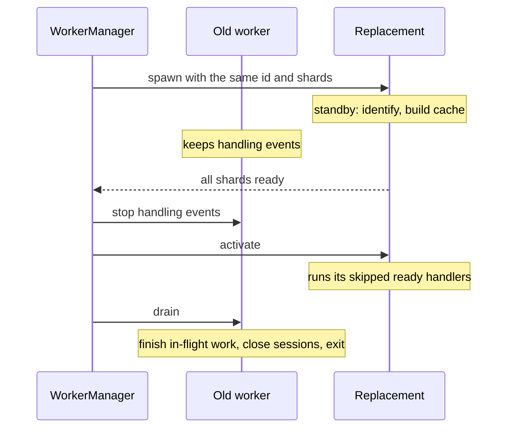

`WorkerManager.hotReload()` replaces running workers with new ones that load all code from disk again. The manager process stays alive, workers are replaced one after another, and each old worker keeps handling events until its replacement is ready.

<Callout type="info">
Rolling worker hot reload is available from Seyfert `6.0.0`. It needs a `WorkerManager`; a plain `Client` has no manager to reload it. To reload command and component files inside a running process instead, see the [hot reload recipe](/docs/recipes/hot-reload).
</Callout>

## How a reload runs



For each worker, the manager:

1. Spawns a replacement with the same worker id and shard range. It identifies new Gateway sessions through the connect queue, with the configured presence.
2. Keeps the replacement on **standby**. It builds its cache and reports readiness, but no event handler, collector or `handlePayload` hook runs in it.
3. Stops the old worker from taking new events once every shard of the replacement is ready, then activates the replacement. The `ready`, `workerShardsConnected` and `workerReady` handlers it skipped run at this point, and `botReady` runs when the worker is the first one.
4. Lets the old worker finish in-flight work for up to `drainTimeout`, then closes its sessions with a normal close and ends it.

If a replacement crashes, fails to load, or is not ready within `readyTimeout`, the manager stops it and the old worker keeps running untouched.

<Callout type="warn" title="Best effort, not lossless">
The old and new workers hold independent Gateway sessions. Events can be missed or delivered twice around the switch, including the cache updates they carry. Do not rely on a hot reload for exactly-once delivery.
</Callout>

## Start a reload from the manager

Call `hotReload()` after every worker is ready. It resolves with one entry per worker it attempted:

```ts twoslash title="manager.ts" showLineNumbers
import { WorkerManager } from 'seyfert';

const manager = new WorkerManager({
    mode: 'clusters',
    path: './dist/worker.js',
});

await manager.start();

process.on('SIGHUP', async () => {
    const result = await manager.hotReload({
        onProgress: ({ workerId, stage }) => console.log(`worker ${workerId}: ${stage}`),
    });

    for (const worker of result.workers) {
        if (!worker.ok) console.error(`worker ${worker.workerId} kept its old code:`, worker.error);
    }
});
```

Deploy the new build to the path the manager already uses, then trigger the reload. The replacement is created from the manager's configuration, so a different `path` or shard layout needs a manager restart.

| Option | Default | Meaning |
| --- | --- | --- |
| `workerIds` | every worker, in id order | Workers to reload, one after another. |
| `readyTimeout` | 60 seconds plus the connect queue time for the worker's shards | How long a replacement may take until all its shards are ready. |
| `drainTimeout` | `10000` | How long a replaced worker may keep finishing in-flight work before its sessions close. |
| `continueOnError` | `false` | Keep reloading the remaining workers after one fails. |
| `onProgress` | none | Called as each worker moves through `spawning`, `connecting`, `ready`, `switching`, `draining` and `done`, or `failed`. |
| `resumeSession` | `false` | Experimental. See [Resume the Gateway session](#resume-the-gateway-session). |

`hotReload()` throws a `SeyfertError` instead of starting when the reload cannot run:

| Code | When |
| --- | --- |
| `HOT_RELOAD_IN_PROGRESS` | Another hot reload is still running. |
| `HOT_RELOAD_UNSUPPORTED` | Not every worker is ready yet, the manager is resharding, or a custom adapter has no `terminate()`. |
| `WORKER_NOT_FOUND` | `workerIds` names a worker the manager does not have. |

A worker that fails during the reload does not throw. It is reported in `result.workers` with `ok: false`.

## Request a reload from a worker

A worker can ask its manager for the same reload with `requestHotReload()`, for example from an owner-only command. It accepts `workerIds`, `readyTimeout`, `drainTimeout`, `continueOnError` and `onProgress`:

```ts twoslash title="worker.ts"
import type { WorkerClient } from 'seyfert';

declare const client: WorkerClient<true>;
// ---cut---
const result = await client.requestHotReload({
    onProgress: ({ workerId, stage }) => client.logger.info(`worker ${workerId}: ${stage}`),
});

const failed = result.workers.filter(worker => !worker.ok);
client.logger.info(`Reloaded ${result.workers.length - failed.length} worker(s), ${failed.length} failed`);
```

When the requesting worker is itself replaced, the promise resolves with the entries so far, including its own, before the worker is told to drain. That leaves time to reply to an interaction or write a log line. Workers reloaded after it are not in that result.

## Lifecycle hooks

A replacement is a whole new thread or process. It runs your startup code next to the old worker while it prepares: services, timers, database or Redis subscribers, and anything else started around `client.start()`. Work that must not run twice needs to know which side of the reload it is on.

`WorkerClient` exposes that state, and a `hotReload` option with four hooks that behave the same in every worker mode:

```ts twoslash title="worker.ts" showLineNumbers
import { WorkerClient } from 'seyfert';

declare const jobs: { start(): void; stop(): void };
declare const players: { saveAll(): Promise<void> };
// ---cut---
const client = new WorkerClient({
    hotReload: {
        // The replacement starts its jobs once it handles events.
        onActivate: () => jobs.start(),
        onStop: () => jobs.stop(),
        // Awaited for up to drainTimeout while REST still works.
        onDrain: () => players.saveAll(),
    },
});

// A worker started normally runs its jobs right away.
if (!client.isHotReloadReplacement) jobs.start();

await client.start();
```

| Hook | Runs when |
| --- | --- |
| `onStandby()` | This worker started as a replacement. It is awaited during `start()`, so its time counts toward `readyTimeout`. |
| `onActivate({ resumed })` | This worker now handles Gateway events. `resumed` is `true` when a stopped worker takes events back because its replacement failed after the switch. |
| `onStop()` | This worker was told to stop handling events. Its replacement takes over next. |
| `onDrain({ timeout })` | This worker is being retired. It is awaited for up to `timeout` milliseconds alongside in-flight work, before plugin teardown and before the shards end, while REST still works. |

Each hook may be async. A hook that throws is logged and does not affect the reload. The old and new workers can run their hooks at the same time, so a job that needs one owner across workers still needs coordination in your application.

`client.hotReloadState` is `'active'`, `'standby'` or `'stopped'`, and stays `'active'` outside a hot reload. `client.isHotReloadReplacement` is `true` for a worker the reload started.

In `'clusters'` mode a drained worker ends with `worker.kill()`, which disconnects the process and sends `SIGTERM`. Put final saves in `onDrain`, and skip restart announcements in your own signal handlers when the worker was only retired by a reload:

```ts twoslash title="worker.ts"
import type { WorkerClient } from 'seyfert';

declare const client: WorkerClient<true>;
declare function announceRestart(): Promise<void>;
// ---cut---
process.on('SIGTERM', async () => {
    if (client.hotReloadState !== 'stopped') await announceRestart();
    process.exit(0);
});
```

## What a replacement keeps

| State | Behavior |
| --- | --- |
| Gateway sessions | New sessions are identified. Every reload uses the session-start allowance of the worker's shards. |
| Presence | Reset to the configured presence. A presence set at runtime is lost. |
| Shards | The worker's configured shard range. Shards added at runtime are not carried over. |
| Memory cache | A `MemoryAdapter` or `LimitedMemoryAdapter` belongs to its worker, so the replacement builds its own from the events it receives. |
| Shared cache | Any other adapter is treated as shared. The replacement does not write to it until it takes over. |
| Collectors, cooldowns, in-memory state | Not transferred. Persist what must survive in `onDrain`. |
| Plugins | Plugin setup, dispatch interceptors and cache adapter startup run while the replacement prepares. Plugin teardown runs in the old worker after it drains. |

With [`trackMemberCount`](/docs/recipes/cache#guild-member-counts), a replacement with its own memory cache takes each guild's count from the `GUILD_CREATE` it receives when it connects. A shared cache keeps the counts the active worker maintains.

## Resume the Gateway session

`resumeSession: true` asks the replacement to continue the old worker's Gateway session instead of keeping its own, so Discord replays the events sent during the switch. The replacement still identifies a session of its own to start up; the old worker's stream pauses while its work drains, and the replacement resumes it from the last sequence the old worker received.

<Callout type="warn" title="Experimental">
Session resume only runs when all of these hold:

- the reload is started with `manager.hotReload()`, not `requestHotReload()`;
- the manager uses `mode: 'threads'` or `mode: 'clusters'`;
- `shardsPerWorker` is `1`;
- every worker uses [`WorkerAdapter`](/docs/learn/scaling/sharding#when-workeradapter-is-appropriate) as its cache.

`hotReload()` throws `HOT_RELOAD_UNSUPPORTED` when the first three do not hold. Without `WorkerAdapter`, the worker is reported as failed and keeps running.

Discord still decides whether the session resumes and replays. Gateway requests sent to the paused worker can time out, and a rollback can replay events the replacement already handled.
</Callout>

```ts twoslash
import type { WorkerManager } from 'seyfert';

declare const manager: WorkerManager;
// ---cut---
await manager.hotReload({ resumeSession: true });
```

## Custom worker adapters

During a reload two instances share one worker id. The manager tells them apart by **generation**: `0` for a worker spawned normally, and `workerData.generation` for a replacement. A `mode: 'custom'` adapter has to route by both values and implement `terminate()`:

```ts twoslash
import type { WorkerManagerOptions } from 'seyfert';

declare const transport: {
    start(workerId: number, generation: number, env: Record<string, unknown>): Promise<void>;
    send(workerId: number, generation: number, body: unknown): Promise<void>;
    stop(workerId: number, generation: number): Promise<void>;
};
// ---cut---
type CustomAdapter = Extract<WorkerManagerOptions, { mode: 'custom' }>['adapter'];

const adapter: CustomAdapter = {
    spawn: (workerData, env) => transport.start(workerData.workerId, workerData.generation ?? 0, env),
    postMessage: (workerId, body, generation = 0) => transport.send(workerId, generation, body),
    terminate: (workerId, generation) => transport.stop(workerId, generation),
};
```

The transport also has to tell the manager which instance a message or an exit belongs to:

```ts twoslash
import type { WorkerManager } from 'seyfert';

declare const manager: WorkerManager;
declare const transport: {
    onMessage(listener: (message: Parameters<WorkerManager['handleWorkerMessage']>[0], generation: number) => void): void;
    onExit(listener: (workerId: number, generation: number, error?: Error) => void): void;
};
// ---cut---
transport.onMessage((message, generation) => manager.handleWorkerMessage(message, generation));
transport.onExit((workerId, generation, error) => manager.handleWorkerExit(workerId, generation, error));
```

Thread and cluster workers are tracked this way automatically.

## Workers placed by the scaler

`@slipher/scaler` supervises its workers without `WorkerManager`, so `hotReload()` does not apply to them. Use the scaler's [rolling deploys](/docs/learn/scaling/operations#rolling-deploys) for a multi-host deployment.
